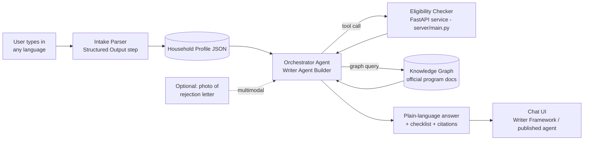

# Government Benefits Navigator — Writer AI Hackathon Build Guide

An assistant where a person describes their situation in plain language (any language) and
gets back: which US federal benefit programs they likely qualify for, what documents they
need, and how to apply — every claim cited to an official `.gov` source.

This repo has the pieces that need to be **real code** (a deterministic eligibility engine,
so results aren't guessed by the LLM). Everything else — the Knowledge Graph, the intake
parser, the chat orchestration, and the front end — you build directly in **Writer AI
Studio**'s no-code Agent Builder, following the steps below.

## What's in this folder

| Path | Purpose |
|---|---|
| `data/schemes.json` | 7 US benefit programs + official source URLs to feed the Knowledge Graph |
| `data/profile_schema.json` | JSON schema for the Intake Parser's structured output |
| `data/tool_schema.json` | Function-calling schema to register the eligibility checker as a Tool |
| `server/` | FastAPI service implementing deterministic eligibility rules (SNAP, Medicaid, SSI, LIHEAP, WIC, EITC, Section 8) |
| `docs_for_knowledge_graph/` | Drop downloaded official PDFs here before upload (empty — see Step 1) |

Programs covered: **SNAP, Medicaid, SSI, LIHEAP, WIC, EITC, Section 8 (Housing Choice
Voucher)**. That's enough breadth to look impressive without you having to hand-model 20
state-specific programs in one weekend.

⚠️ **Before your demo**: the FPL thresholds in `server/rules.py` are 2024 HHS Federal
Poverty Guidelines used as an illustrative baseline. Check
https://aspe.hhs.gov/poverty-guidelines for the current numbers and update the constants
if needed — this is exactly the kind of detail a judge might spot-check.

---

## Architecture



The key design point for judges: **the LLM never decides eligibility on its own.** It calls
the deterministic `check_eligibility` tool for the yes/no/maybe, and uses the Knowledge
Graph only to explain *why* and cite *where that rule comes from*. This is the difference
between "sounds right" and "is right" — worth saying out loud in your pitch.

---

## Step 1 — Gather source documents for the Knowledge Graph

Pull the official pages/PDFs for each program in `data/schemes.json` (`official_sources`
field has direct links). For each program, save at minimum:
- the eligibility rules page (as PDF or the page saved to PDF)
- the "how to apply" page
- if available, the official pre-screening/documents-checklist page

Save them into `docs_for_knowledge_graph/`, named like `snap_eligibility.pdf`,
`snap_apply.pdf`, `medicaid_eligibility.pdf`, etc. Doing this offline first means you're not
dependent on venue Wi-Fi when you upload to Writer, and you control exactly what's in the
graph (important for the "cites official source" requirement — you want *only* authoritative
docs in there, no blog posts).

## Step 2 — Build the Knowledge Graph in Writer AI Studio

1. In Writer AI Studio, go to **Knowledge Graph** → **Create Graph**. Name it e.g.
   `us-benefits-programs`.
2. Upload every file from `docs_for_knowledge_graph/`.
3. Tag/organize by program if Studio's UI supports folders or metadata — this makes it
   easier later to scope a query to "just SNAP" if you want tighter citations.
4. Once indexing finishes, use Studio's built-in graph chat/test panel to sanity-check
   retrieval: ask "What's the income limit for SNAP?" and confirm it answers *and* shows a
   citation back to the USDA page you uploaded. Do this for at least 3 programs before
   moving on — catching a bad citation now is much cheaper than during judging.

## Step 3 — Build the Intake Parser

In **Agent Builder**, create a new agent (e.g. `benefits-navigator`). Add a first step that
takes the user's raw message and produces structured output.

1. Add a **Structured Output / JSON mode** step (Writer's chat completions support
   structured/JSON responses).
2. Paste the schema from `data/profile_schema.json` as the target JSON schema.
3. System prompt for this step, roughly:

   > Extract a structured household profile from the user's message, which may be in any
   > language. Detect and record the language in the `language` field. If a required field
   > (household size, income) is missing or ambiguous, add its name to
   > `missing_critical_fields` instead of guessing a number. Never invent income, age, or
   > household size — only extract what the user actually said.

4. Test with a message like: *"Soy madre soltera con dos hijos, gano 2200 al mes en
   California, uno de mis hijos tiene 3 años."* Confirm it correctly extracts
   `household_size: 3`, `monthly_household_income: 2200`, `state: "CA"`,
   `has_children_under_5: true`, `language: "es"`.

## Step 4 — Register the eligibility checker as a Tool

The rules engine needs to be reachable over HTTPS for Writer's tool-calling to hit it.

1. Locally:
   ```bash
   cd server
   pip install -r requirements.txt
   uvicorn main:app --reload --port 8000
   ```
2. Expose it publicly for the hackathon (pick one):
   - `ngrok http 8000` — fastest for a live demo, URL changes each restart
   - Deploy to Render/Railway/Fly.io free tier — more stable if you're demoing over
     multiple sessions
3. Test it directly first:
   ```bash
   curl -X POST https://<your-url>/check-eligibility \
     -H "Content-Type: application/json" \
     -d '{"household_size":3,"monthly_household_income":2200,"state":"CA","has_children_under_5":true}'
   ```
   You should get back a `results` array with one entry per program, each with
   `eligible`, `confidence`, `reason`, and `citation`.
4. In Agent Builder, add a **Custom Tool / Function** to your agent. Use
   `data/tool_schema.json` as the function definition, and point its endpoint at
   `https://<your-url>/check-eligibility`.

## Step 5 — Wire the Orchestrator Agent

This is the main agent step that ties intake → tool → knowledge graph → answer together.
System prompt, roughly:

> You are a government benefits navigator. Given a household profile, you must:
> 1. Call `check_eligibility` with the household profile to get deterministic results —
>    never guess eligibility yourself.
> 2. For each program the tool returns, use the Knowledge Graph to pull the specific
>    documents needed and the application steps, and cite the exact source used.
> 3. Respond in the user's detected language.
> 4. Format the answer as a checklist per program: Program name → Likely eligible? →
>    Why (one sentence, from the tool) → Documents needed → How to apply → Source link.
> 5. If `missing_critical_fields` is non-empty, ask ONE clarifying question for the most
>    important missing field before finalizing results — don't run the tool with guessed
>    numbers.
> 6. Never state an eligibility determination without a citation attached.

Enable both the Knowledge Graph and the Custom Tool as available resources for this agent
step (Writer's chat/tool-calling lets the model choose to call the tool and/or query the
graph within one turn — see Writer's docs on tool calling with Knowledge Graph + custom
functions).

## Step 6 — Language layer

Since the Intake Parser already detects `language`, the simplest approach is a single
instruction in the Orchestrator's system prompt: "Always respond in the language given in
the profile's `language` field, translating program names and document names naturally
rather than leaving them in English." Test end-to-end in at least one non-English language
(Spanish is the highest-value one for a US benefits demo) before the hackathon — translation
of legal/document terms is exactly where models wobble, so check it doesn't mistranslate
something like "Social Security number."

## Step 7 (optional, high demo value) — Document reader for rejection letters

If time allows, add a second entry point: user uploads a photo/PDF of a denial letter or
notice.

1. Add a multimodal chat step using Writer's multimodal model (Palmyra X5) with image/PDF
   input enabled.
2. Prompt: "Extract the program name, the stated reason for denial/notice, and any deadline
   or case number from this document. Then pass this back into the household-profile flow
   so the navigator can suggest what to fix or re-apply for, citing the relevant official
   rule from the Knowledge Graph."
3. This is a great live demo beat: "confused person holding a denial letter" → photo →
   plain-language explanation of what went wrong and what to do next.

## Step 8 — Front end

Fastest paths, pick based on how much of the day is left:
- **Publish the agent directly** from Writer AI Studio if it offers a shareable chat
  widget/link — zero extra build time, good enough for judging.
- **Writer Framework** app with a simple chat panel + a checklist component below it that
  renders the structured per-program results (eligible/documents/apply link) — better visual
  "wow" for judges since they see a checklist materialize, not just chat text.

Either way, make sure the UI visibly renders citations (e.g., as clickable source links per
checklist item) — that's the single most important thing to make visible on screen, since
it's the core differentiator from a generic chatbot.

## Step 9 — Demo script (suggested 90 seconds)

1. Type/speak a real-sounding situation in Spanish or another non-English language.
2. Show the assistant asking one clarifying question if a field's missing (proves it's not
   guessing).
3. Show the checklist output: 3-4 programs, each with eligible/documents/apply link/citation.
4. Click a citation to show it lands on the actual .gov page.
5. (If built) upload a mock rejection letter photo and show the follow-up explanation.
6. Closing line: "Nothing here was guessed — the eligibility calls came from a deterministic
   rules engine, and every explanation is grounded in an official source via the Knowledge
   Graph."

---

## Known limitations to preempt in Q&A

- Medicaid and Section 8 thresholds are genuinely state/county-specific; the demo uses
  national approximations and flags them as `needs_state_check` / `rough_estimate` rather
  than a hard yes — call this out proactively, it shows rigor rather than a gap.
  If a judge asks, you already have the answer.
- FPL constants need an annual update — mention you'd wire this to HHS's published API/CSV
  in a production version instead of hardcoding.
- This is federal-programs only; state-specific programs (a huge chunk of real-world value)
  would be the natural "next step" answer if asked about roadmap.
